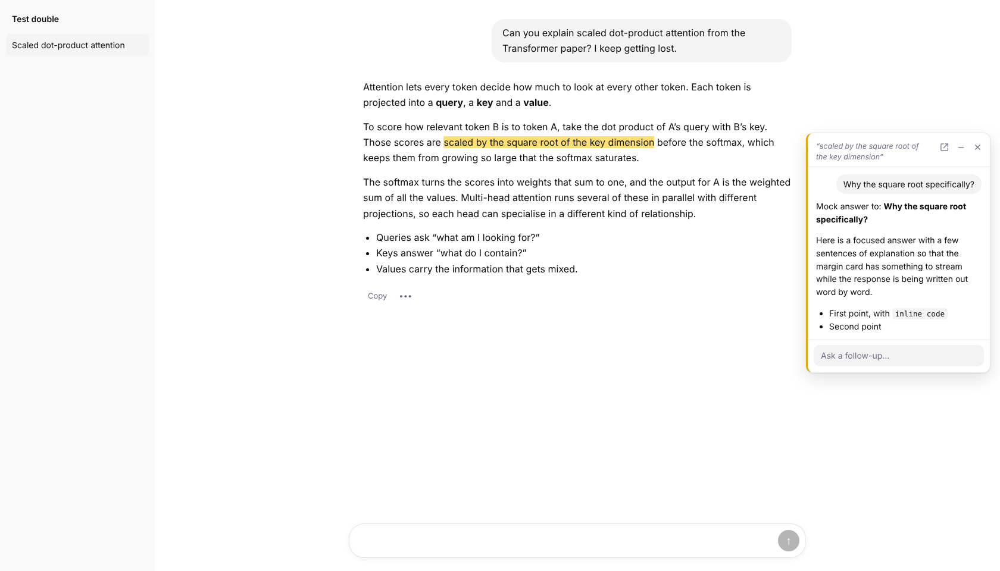

# Marginalia for ChatGPT

Highlight any part of a ChatGPT conversation, click **Ask**, and ask a side question in a card in the
margin, right next to the text you're reading. The answer streams into the card, you can keep asking
follow-ups there, and your main conversation never moves. Close the card and the highlight stays, so
you can click it later to reopen the thread.

It runs on your normal ChatGPT subscription, in your browser. It doesn't use the OpenAI API and needs no API key.

<picture>
  <source media="(prefers-color-scheme: dark)" srcset="docs/card-dark.png">
  
</picture>

<sub>Screenshot from the test suite's stand-in page, not the real chatgpt.com.</sub>

## Install

1. Download or clone this repo.
2. Open `chrome://extensions`, turn on **Developer mode**, click **Load unpacked**, and pick the repo folder.
3. Open a conversation on [chatgpt.com](https://chatgpt.com), select some text, and click **Ask**.

Works in Chrome, Edge, Brave and Arc (Chrome 111+).

## Using it

- **Ask:** select text in any message (yours or ChatGPT's), then click the **Ask** button that appears under it.
- **Send:** press Enter to send and Shift+Enter for a new line.
- **Collapse:** press Esc or click **–**. The thread shrinks to a small marker in the margin, and the text stays highlighted.
- **Reopen:** click the highlighted text or the marker. Side threads are saved per conversation, so they survive reloads.
- **Open in ChatGPT:** **↗** opens the side thread as an ordinary ChatGPT chat.
- **Delete:** **×** deletes the side thread, and (by default) its chat in ChatGPT.

On a wide window the card sits in the empty margin beside the conversation. When there isn't room,
it opens just under the line you highlighted.

## How it gets answers with your full context

The first time you ask a side question, the extension opens a **pinned helper tab** on chatgpt.com.
In that tab it uses ChatGPT's own **Branch in new chat** on the latest response. That makes a new chat
that starts with your whole conversation, so the answer has the same context as the main chat. The
extension types your question there, with the passage you highlighted quoted for reference. It reads
the answer as it streams and shows it in your card.

- **Each side thread is its own branch.** Side questions never mix with each other or with your main chat.
- **Follow-ups stay in the same branch.**
- **The main chat is never touched.** Before it sends anything, the helper refuses to post if it's looking at your main conversation.
- **If branching isn't offered** (for example, in a temporary chat), it falls back to a new chat with the
  conversation's text pasted in. Text carries over that way, but uploaded files don't. You can pick this
  mode permanently in the settings (click the extension's toolbar icon).

You need to be signed in to ChatGPT. Questions run one at a time in the helper tab. Keep the helper tab
open (it's pinned, so it stays out of the way).

## Things to know

- **Branch chats show up in your ChatGPT history** while a side thread exists. Deleting the side thread
  deletes its chat too. You can turn that off in the settings.
- **Files:** a branch copies the conversation. Whether ChatGPT also gives the branch your uploaded files
  is up to ChatGPT; Project files stay available because the branch stays in the Project.
- **It depends on ChatGPT's page structure.** When ChatGPT changes its markup, things can break. Everything
  that touches ChatGPT's page is in [`src/content/chatgpt.js`](src/content/chatgpt.js), and that file is
  usually the only one that needs a fix.
- **Your data stays local.** Side threads are saved in the extension's local storage on your computer.
  Nothing is sent anywhere except chatgpt.com.
- **Automation:** this drives ChatGPT's web page on your behalf, at the pace you ask questions. It's a gray
  area in OpenAI's terms. Personal, low-volume use is the intent.

## Troubleshooting

| What you see | What to do |
| --- | --- |
| "No response from the helper tab" | Check that the pinned ChatGPT tab is open and signed in. Reload it and retry. |
| Every question falls back to "new chat with the transcript" | ChatGPT may have renamed or moved **Branch in new chat**. Update `findMoreActions` / `findBranchItem` in `src/content/chatgpt.js`. |
| Nothing gets typed or sent | The message box or Send button selectors changed: `SEL.composer` / `SEL.send` in `src/content/chatgpt.js`. |
| Answers stop appearing mid-stream | Chrome can slow down background tabs. Click the helper tab once, or turn off Memory Saver / Energy Saver for chatgpt.com. |

## Development

```
src/background.js         routes questions from your tabs to the helper tab, one at a time
src/content/chatgpt.js    everything specific to ChatGPT's page (selectors, branching, typing, reading)
src/content/anchor.js     saves highlights as quoted text, so they're found again after reloads
src/content/reader.js     the margin UI: Ask button, highlights, cards, saved threads
src/content/worker.js     runs a question in the helper tab and streams the answer back
src/options/              settings page
tests/mock/               a stand-in for chatgpt.com with the parts of its DOM the extension uses
tests/e2e.mjs             end-to-end test of the whole flow in Chromium
```

```bash
npm install
npm test        # loads the extension in Chromium against the stand-in page
npm run lint
```

The end-to-end test loads the real extension into Chromium. It points `chatgpt.com` at a local HTTPS
server that serves `tests/mock/`, so every tab hits the stand-in, including the helper tab the
extension opens itself. It covers highlight → ask → branch → streamed answer → follow-up → collapse →
reload → reopen → delete, and the transcript fallback. It also checks that the main conversation is
never posted to and that your scroll position doesn't move. Run with `HEADED=1` to watch.
